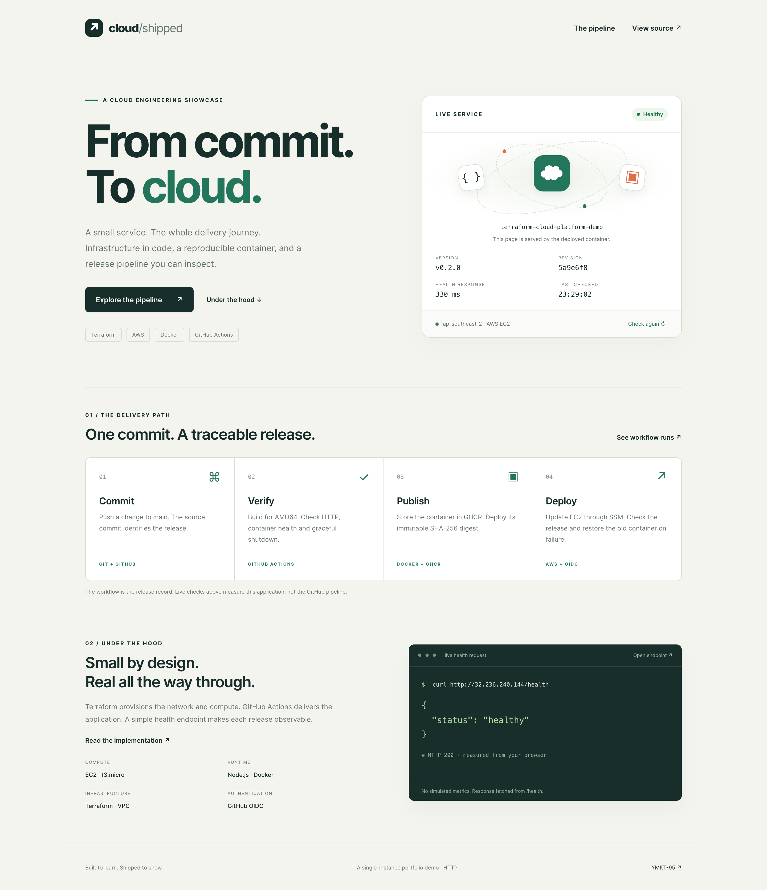
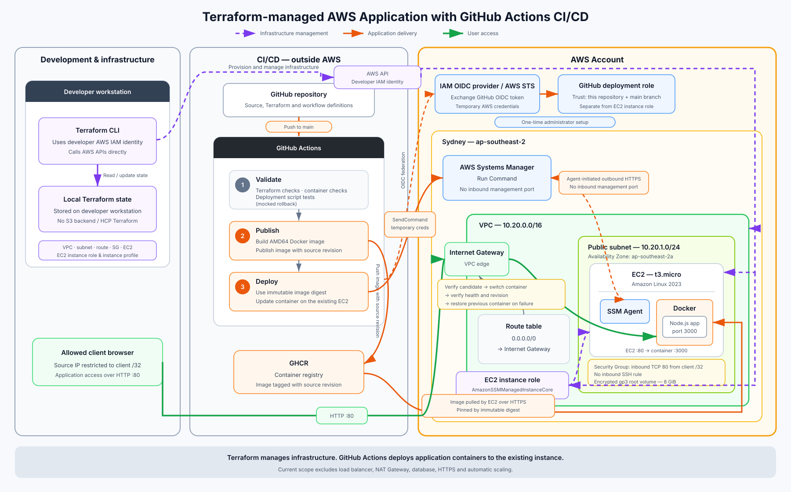
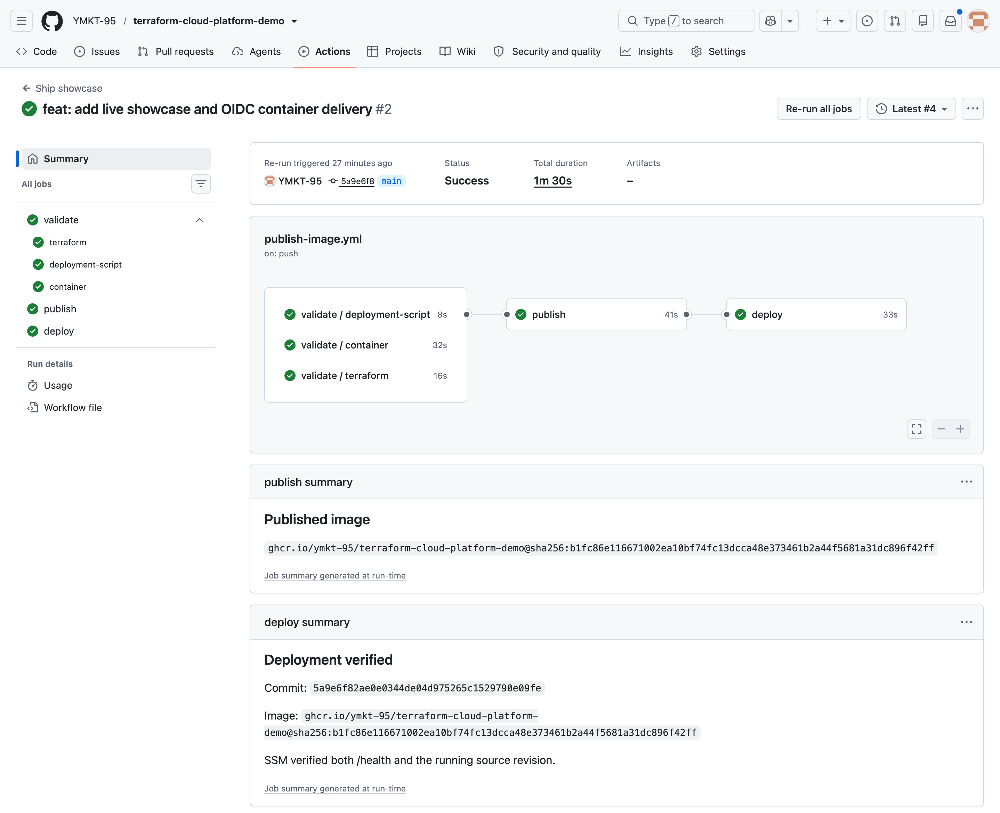
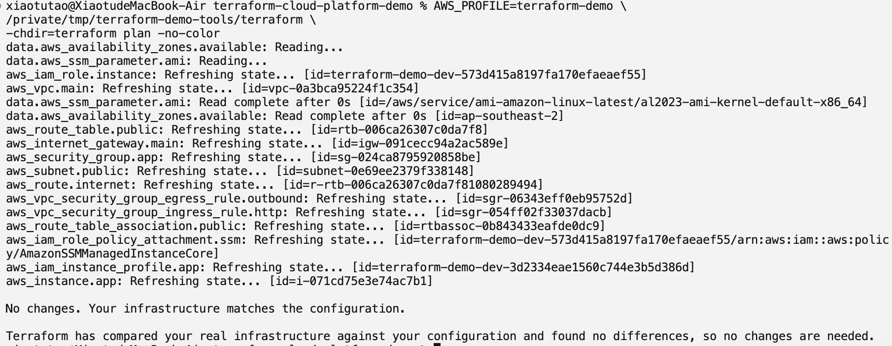
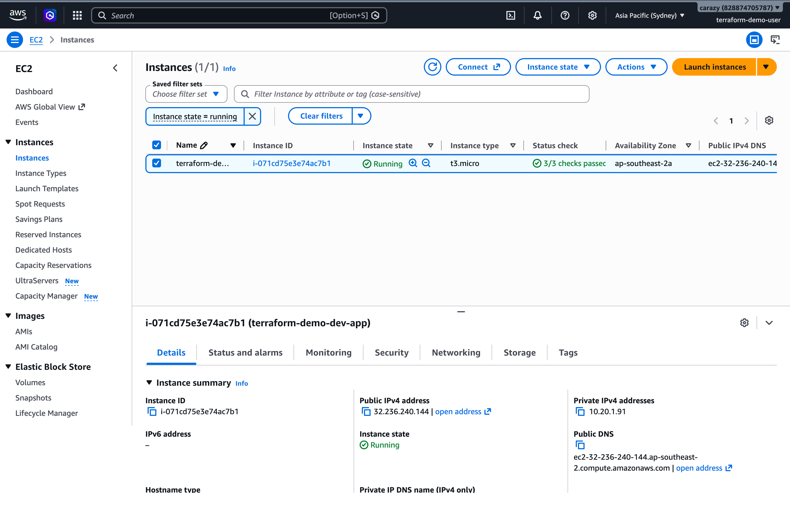
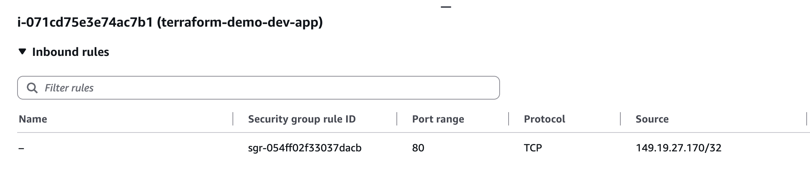

# From commit. To cloud.

### Terraform · AWS · Docker · GitHub Actions

A cloud engineering portfolio project demonstrating the delivery of a containerized Node.js application to AWS: Terraform provisions the infrastructure, GitHub Actions validates and publishes the image, and AWS Systems Manager deploys it using temporary OIDC credentials.

**[Implementation repository](https://github.com/YMKT-95/terraform-cloud-platform-demo)** · **[Successful release](https://github.com/YMKT-95/terraform-cloud-platform-demo/actions/runs/37365003260/attempts/4)** · **[Architecture](assets/architecture.svg)** · **[Evidence record](docs/evidence.md)**

*The application serves its own showcase page. Health, version and revision are fetched from application endpoints. This screenshot records a verified deployment; it is not a live status indicator for this repository.*

## Project goal

Connect infrastructure as code, container packaging and automated delivery in a small deployment that can be inspected from source commit to running application. The application is deliberately simple so the engineering work is visible: network provisioning, identity boundaries, release validation and recovery behavior.

This repository presents the architecture and deployment evidence. Application code, Terraform configuration, tests and executable workflows live in the [implementation repository](https://github.com/YMKT-95/terraform-cloud-platform-demo). The workflow screenshots below belong to that repository.

## What the project demonstrates

- **Infrastructure as code:** a VPC, public subnet, internet gateway, routing, security group, EC2 instance and its SSM identity, managed with Terraform.
- **Continuous integration:** Terraform checks and mocked plans, AMD64 container smoke tests, and deployment script tests with mocked failure and recovery scenarios.
- **Traceable releases:** the source revision is embedded in the image; deployment uses an immutable SHA-256 image digest and verifies the running revision.
- **Temporary deployment credentials:** GitHub Actions assumes an AWS role through OIDC, with trust restricted to the implementation repository's `main` branch.
- **Deployment without inbound SSH:** SSM Run Command updates the container on the existing instance. The instance agent establishes outbound HTTPS connections.
- **Recovery behavior:** the script checks a candidate container before cutover and attempts to restore the previous container if cutover verification fails.

## Architecture

*Open the diagram to inspect it at full size.*

There are three separate paths:

1. **Infrastructure management.** Terraform runs on the developer workstation using a developer IAM identity. State is stored locally. It manages the AWS network, compute and EC2 instance role/profile.
2. **Application delivery.** GitHub Actions validates the source, publishes an AMD64 image to GHCR, obtains temporary AWS credentials through OIDC, and invokes SSM to deploy that image by digest. The OIDC provider and GitHub deployment role were configured once by an administrator.
3. **Application access.** An allowed client reaches the EC2 public address over HTTP port 80, mapped to port 3000 inside the Node.js container. Inbound HTTP is restricted to the configured client `/32`.

The deployment uses one `t3.micro` instance running Amazon Linux 2023 in `ap-southeast-2a`, inside a `10.20.1.0/24` public subnet and `10.20.0.0/16` VPC. The root volume is encrypted, 8 GiB, and uses gp3 storage.

Terraform manages infrastructure. Routine CD releases replace the application container without running `terraform apply` or replacing EC2. The developer IAM identity, GitHub deployment role and EC2 instance role have separate responsibilities.

## CI/CD: a verified release

*The successful release shows all three validation jobs, publishing and deployment completed. The summaries record the source commit, immutable image digest and verification of both health and revision.*

The **Ship showcase** workflow follows this sequence:

1. Validate Terraform, the container and deployment scripts.
2. Build and test an AMD64 image, embed its source revision, publish to GHCR and verify anonymous pulling.
3. Exchange a GitHub OIDC token for temporary AWS credentials.
4. Send the deployment script through SSM to the scoped EC2 instance.
5. Pull the exact image digest and verify a candidate container on a temporary local port.
6. Switch containers, verify `/health` and the running revision, and record the result in the workflow summary.

The previous container is retained for recovery. Deployment script tests cover candidate failure, failed cutover recovery, successful replacement and rejection of mutable image tags. These are mocked tests; a live AWS failure-and-rollback drill has not been performed.

The recorded application version is **0.2.0**, built from [`5a9e6f8`](https://github.com/YMKT-95/terraform-cloud-platform-demo/commit/5a9e6f82ae0e0344de04d975265c1529790e09fe). The application screenshot and workflow summary show the same source revision. Full identifiers are preserved in the [evidence record](docs/evidence.md).

## Infrastructure verification

*Terraform reported “No changes. Your infrastructure matches the configuration.” after refreshing the managed resources. This demonstrates infrastructure consistency at the time of capture; application version verification is handled separately by CD.*

*The `terraform-demo-dev-app` instance is running in Sydney, with all three EC2 status checks passed. EC2 checks and application health checks are separate evidence.*

## Access and identity

*Inbound HTTP access is restricted to a single client IP. No inbound SSH rule is configured.*

- The GitHub deployment role can send commands to the configured demo instance and retrieve command results. This is administrative command execution on that instance, so trusted workflow changes matter.
- The EC2 instance role uses `AmazonSSMManagedInstanceCore` for Systems Manager connectivity.
- No long-lived AWS access keys are stored in GitHub for deployment. The publishing job uses `GITHUB_TOKEN`; the public GHCR image can be pulled anonymously by EC2.
- Container verification checks that the application runs as a non-root user and handles graceful shutdown.

## Engineering decisions and lessons

**Keep infrastructure and application delivery separate.** Terraform remains responsible for the machine and network; SSM updates the running application. Rebuilding EC2 requires reviewing the bootstrap image, updating the CD target and IAM resource scope, and deploying the desired release again.

**Deploy an exact artifact.** An immutable digest identifies the image to run. Checking the embedded source revision confirms that the responding application is the intended release, beyond a successful HTTP response alone.

**Verify from the instance.** The GitHub runner uses SSM to check the application's local endpoints, so its changing public IP does not require an inbound HTTP or SSH rule.

**Distinguish scheduling failures from code failures.** Earlier release attempts failed because a GitHub-hosted runner was not assigned. Retrying the failed jobs later completed publishing and deployment for the same source commit. The final successful run is linked above.

## Scope and next steps

This is a single-instance learning and portfolio deployment. It uses HTTP and local Terraform state; it does not include TLS, a load balancer, autoscaling, a database or high availability. Container cutover can cause a brief interruption. Recovery is attempted on failure, not guaranteed.

The screenshots were captured on **7–8 October 2026 (Pacific/Auckland)**. The AWS application was accessible only from the configured client IP; this public repository is the shareable showcase and does not promise a publicly accessible or continuously running demo endpoint.

Next steps include a live rollback drill, restart recovery and cleanup verification, followed by shared remote state, HTTPS and infrastructure modularization as the project grows.

## Explore the implementation

- [Terraform configuration](https://github.com/YMKT-95/terraform-cloud-platform-demo/tree/5a9e6f82ae0e0344de04d975265c1529790e09fe/terraform)
- [Release workflow](https://github.com/YMKT-95/terraform-cloud-platform-demo/blob/5a9e6f82ae0e0344de04d975265c1529790e09fe/.github/workflows/publish-image.yml)
- [Validation workflow](https://github.com/YMKT-95/terraform-cloud-platform-demo/blob/5a9e6f82ae0e0344de04d975265c1529790e09fe/.github/workflows/validate.yml)
- [Deployment scripts](https://github.com/YMKT-95/terraform-cloud-platform-demo/tree/5a9e6f82ae0e0344de04d975265c1529790e09fe/scripts)
- [Application and Dockerfile](https://github.com/YMKT-95/terraform-cloud-platform-demo/tree/5a9e6f82ae0e0344de04d975265c1529790e09fe/app)
- [Setup and verification walkthrough](https://github.com/YMKT-95/terraform-cloud-platform-demo/blob/7681dc8/docs/phase-3.md)

Built by [YMKT-95](https://github.com/YMKT-95).
